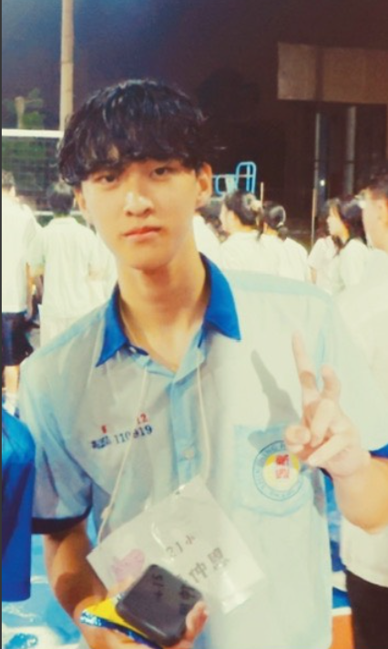

# comfyUI生成圖片

## 原圖

## 生成的圖

## 完整工作流截圖

## 顯示使用的正反提示詞
正面提示詞 (Positive Prompt)
(masterpiece, best quality, highest quality:1.2), ultra-detailed, 8k resolution, highly detailed digital art, sharp focus, beautiful lighting, cinematic lighting, professional composition.

反面提示詞 (Negative Prompt)
(worst quality, low quality:1.4), text, error, extra limbs, fewer digits, cropped, worst quality, low quality, normal quality, jpeg artifacts, signature, watermark, username, blurry, artist name, mutation, disfigured.

## 個人心得
### 這是我第一次使用 ComfyUI 來合成 AI 圖片，感覺真的非常有趣 雖然一開始看到那些密密麻麻的節點和連線有點眼花撩亂、像在學寫程式一樣，但實際跑出圖片的那一刻超有成就感。比起傳統介面，它能自由掌控每一個步驟和參數，玩起來彈性十足，也讓我對 AI 繪圖有了全新的體會# comfyUI生成圖片